# 内製化で全てを解決するためのプロダクトハーネス（10分LT 原稿）

- 形式: 1スライド = `---` で区切った1ブロック。各ブロックは「スライド本文」と「🗣 話すこと」（スピーカーノート）で構成する
- 主張: 共通課題を吸収し AI の暴走を防ぐ「プロダクトハーネス（認証認可・デザインシステム・高速CIとSkills）」を整えれば、新規アプリ開発は「固有のロジック」だけに集中でき、2〜3時間で本番品質になる
- 持ち帰ってほしいもの:
  1. 3軸それぞれの具体的な設計（何を共通化し、何を機械的に強制するか）
  2. 最初から基盤を作らず「困ってから切り出す」進化のさせ方
- 流れと時間配分（計10分 / 全18スライド）
  1. 掴みと背景（2分）: スライド 1–4（自己紹介、SaaS課金の悩み、20以上のアプリを月$5・数時間で量産する現在地）
  2. 主張と全体像（1分）: スライド 5–6（なぜ速いのか？ 3つの壁とプロダクトハーネスの全体像）
  3. 軸①: 認証認可基盤（1.5分）: スライド 7–8
  4. 軸②: デザインシステム（1.5分）: スライド 9–10
  5. 軸③: ハーネスエンジニアリング（1.5分）: スライド 11–13
  6. 土台と伏線回収（1分）: スライド 14–15（Cloudflare の土台 ＋ 当日深夜から3時間で本番投入した2事例）
  7. 実践の急所とまとめ（1.5分）: スライド 16–18（最初から基盤を作るな・最初は汚くていい・まとめ）
- 題材: `gdg-jp/gdgjp` モノレポ。数値と日付は git log と CI の計測ログから取った

---

## 1. タイトル

# 内製化で全てを解決するためのプロダクトハーネス

〜コミュニティ運営の「困った」を、2〜3時間で本番品質のアプリにする〜

ゆにねこ / GDG Greater Kwansai / 2026-xx-xx

> 🗣 今日は、コミュニティ運営のあらゆる「困った」を、自分でアプリを作って解決してきた話をします。
> ただし、今日の主役は個々のアプリではありません。
> 新しいアプリをわずか2〜3時間で、しかも使い捨てではなく「本番品質」で作れるようにしてくれる「基盤」の話をします。

---

## 2. 自己紹介

**ゆにねこ**

- Google Developer Group Greater Kwansai Organizer
- AIAU staff
- 大阪大学
- `gdgs.jp` のアプリ群（20以上）を、ほぼ1人で作っている

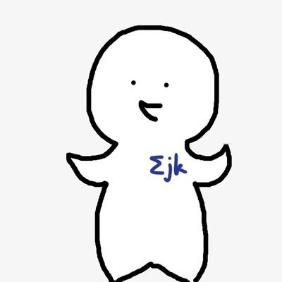
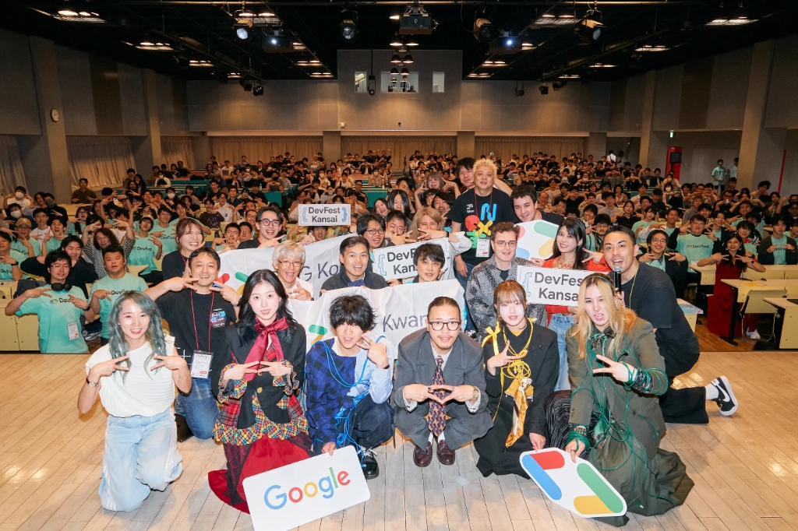

> 🗣 ゆにねこです。
> GDG Greater Kwansai のオーガナイザーと AIAU のスタッフをしていて、大阪大学に在籍しています。
> 先日も関西で大規模なカンファレンス DevFest Kansai を開催したのですが、そうしたコミュニティ運営のかたわら、今日お話しする `gdgs.jp` の20以上のアプリ群を、ほぼ1人で作って運用しています。

---

## 3. 発端: コミュニティ運営の「困った」と SaaS 課金の壁

- 告知用の短縮リンクに `dub.sh` を使っていた
  - クリック数の分析と独自ドメインを使うには Pro プラン（月 $30）が必要
- ほかにも運営で欲しいツールは山ほどある
  - Wiki、画像置き場、日程調整、SNS 予約投稿、経費精算、シフト表、受付チェックイン…
- ボランティア運営で、SaaS の月額をツールごとに払い続けるのはつらい
- **「ないなら、全部自分で作ればいいのでは？」** → 内製化へ
  - いまは **20以上のアプリすべてが Cloudflare Workers Paid の月 $5** に収まっている

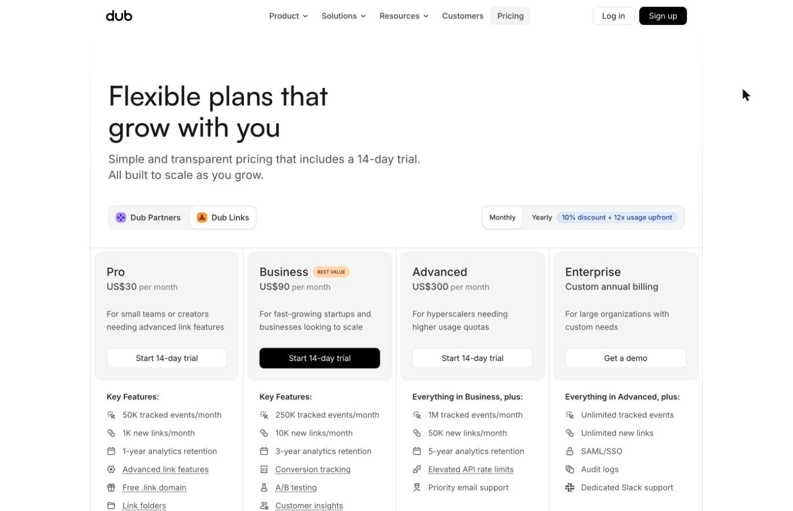
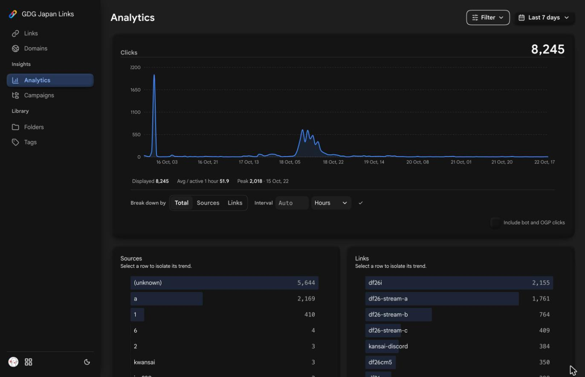

> 🗣 きっかけはお金とツールの悩みでした。
> たとえば告知用の短縮リンクに dub.sh を使っていましたが、クリック分析や独自ドメインを使うには月30ドルの Pro プランが必要でした。
> 他にも Wiki や日程調整、経費精算など欲しいものは山ほどありますが、ボランティア運営で SaaS に毎月課金し続けるのは無理があります。
> そこで「全部内製しよう」と振り切りました。今では20以上のアプリすべてが、Cloudflare Workers Paid の月5ドルだけで動いています。

---

## 4. いま起きていること: イベント当日の深夜0時から3時間で本番投入

**例: `mc.gdgs.jp`（リモート MC 音声プレイヤー / DevFest Kansai 2026 当日）**

| 時刻（2026-10-18） | できごと |
| --- | --- |
| **00:00** | 「リモートMCの音声をOBSに流す仕組みが必要だ」と着手 |
| **01:59** | 最初のコミット（116ファイル、約1.1万行） |
| **02:50** | トラックごとのチャンネル（Durable Object）に分割 |
| **03:14** | 残り時間のカウントダウン実装。**本番で使う機能が揃う** |
| **06:11** | 管理画面からのクリップのアップロード・編集・削除まで追加 |

- 2日後には、WebRTC SFU を使った登壇者映像システム（`screen.gdgs.jp`）も **約3時間半** で本番品質に

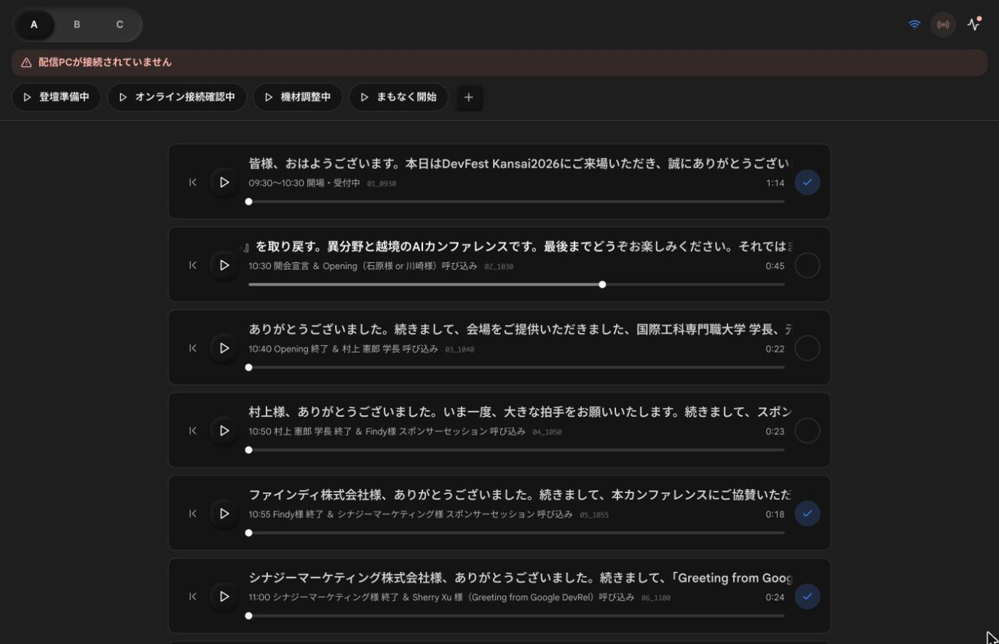

> 🗣 しかも、ただ安上がりなだけではありません。開発スピードが劇的に変わりました。
> これは先日の DevFest Kansai 2026 当日の実話ですが、深夜0時に「リモートMCの音声を会場のOBSに流すアプリが必要だ」となり、そこから作り始めました。
> 午前3時14分には認証・管理画面・リアルタイム通信を備えた本番品質のアプリが完成し、その日のイベントで実際に稼働しました。
> なぜ1人で、たった3時間でこんなことができるのでしょうか？

---

## 5. なぜ2〜3時間で「本番品質」になるのか？（今日の主張）

AI に「アプリを作って」と丸投げしているからではない。
アプリを増やす中でぶつかった **「3つの壁」を基盤（ハーネス）が吸収しているから**。

| アプリ量産の壁 | 解決する3つの軸 | 新規アプリ開発で起きること |
| --- | --- | --- |
| **① 認証・権限の壁**<br>毎回ログインと運営権限を作るのが手間 | **認証認可基盤**<br>`accounts.gdgs.jp` | 関数を1つ呼ぶだけで OIDC ログインとチャプター権限が揃う |
| **② UI とプロンプト疲れの壁**<br>画面がバラバラで毎回AIへの指示が長い | **デザインシステム**<br>`packages/design-system` | プロンプトで注文しなくても、最初から GDG らしい画面が出てくる |
| **③ 品質崩壊とCI待ちの壁**<br>AIが既存を壊す・CIが遅いと飛ばされる | **ハーネスエンジニアリング**<br>高速 pre-commit CI & Skills | 1秒〜1分のチェックで壊れたコードを弾き、作業手順にも迷わない |

> **基盤（プロダクトハーネス）を整えれば、人間も AI も「そのアプリ固有のロジック」だけに集中できる。**

> 🗣 「AI に丸投げしているから速いんでしょ？」と思われるかもしれませんが、違います。
> 1個目のアプリなら AI だけで作れますが、10個、20個と増やすと「認証の重複」「UIのバラつき」「AIがコードを壊す問題」に必ずぶつかります。
> 今日の主張はシンプルです。認証認可、デザインシステム、ハーネスという3つの基盤を整えれば、考えるべきことが「そのアプリ固有のロジック」だけになり、新規開発は驚くほど速く、手軽で、高品質になります。

---

## 6. `gdgs.jp` の進化年表: 20以上のアプリと基盤の歩み

| 時期 | できごと（アプリと基盤の進化） |
| --- | --- |
| **2026-02** | 1つ目のアプリ `wiki.gdgoc-osaka.jp` だけを作った（基盤なし） |
| **2026-04** | 2つ目の `tinyurl` でログインが必要に → **① 認証認可基盤（`accounts`）** を実装 |
| **2026-05〜09** | `img`, `scheduler`, `sns`, `pay`, `connpass`, `ost`, `roster`… と急増 |
| **2026-07〜10** | アプリが10個を超え、UIのバラつきが限界に → **② `design-system`** を切り出し |
| **2026-10** | **③ 高速CI・Skills** も揃い、`mc` と `screen` をそれぞれ2〜3時間で本番投入 |

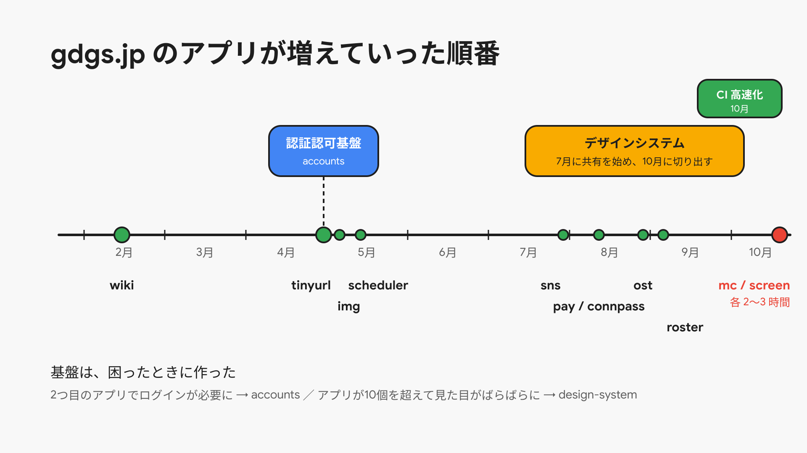
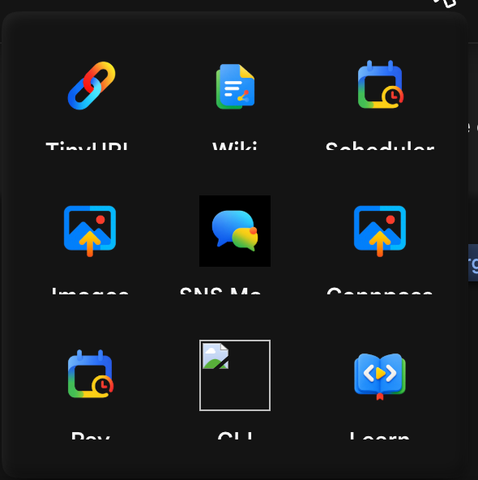
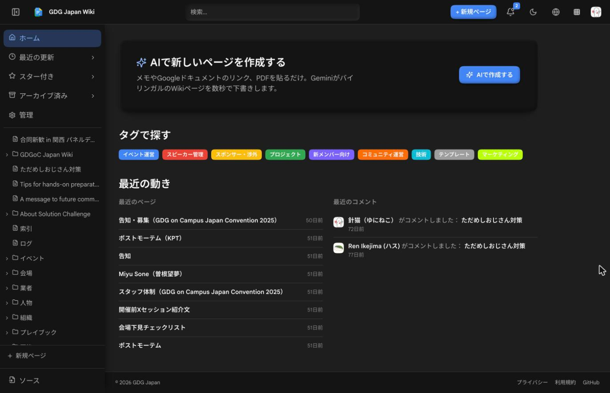

> 🗣 具体的な中に入る前に、全体の時系列だけ共有します。
> 今年の2月に最初の Wiki を作ったときは、基盤なんて何もありませんでした。
> 4月に2つ目の短縮リンクを作るときに認証基盤ができ、夏にアプリが10個を超えてからデザインシステムが生まれました。
> こうして段階的に育った3つの軸を、順番に見ていきます。

---

## 7. 軸①: 認証認可基盤 `accounts.gdgs.jp`

- **きっかけ**: 2つ目のアプリ（`tinyurl`）でもログインが必要になった
- **IdP の構成**
  - Cloudflare 公式の `workers-oauth-provider`（OAuth 2.1）、Google ログイン、D1 と KV
  - OIDC に準拠し、20近いアプリがこの IdP の Relying Party になっている
  - チャプターとメンバーシップを、ここで一元管理する
- **新規アプリ側でやること: 共通ライブラリの `initializeRpAuth(...)` を呼ぶだけ**
  - サインイン、コールバック、サインアウト、ログイン中ユーザー取得のルートが自動で揃う
  - セッションは HMAC 署名 Cookie に載せるため、アプリ側の DB にセッションテーブルすら不要

```text
accounts.gdgs.jp (IdP) ──OIDC──▶ tinyurl / wiki / img / scheduler / sns / pay / mc / screen …
```

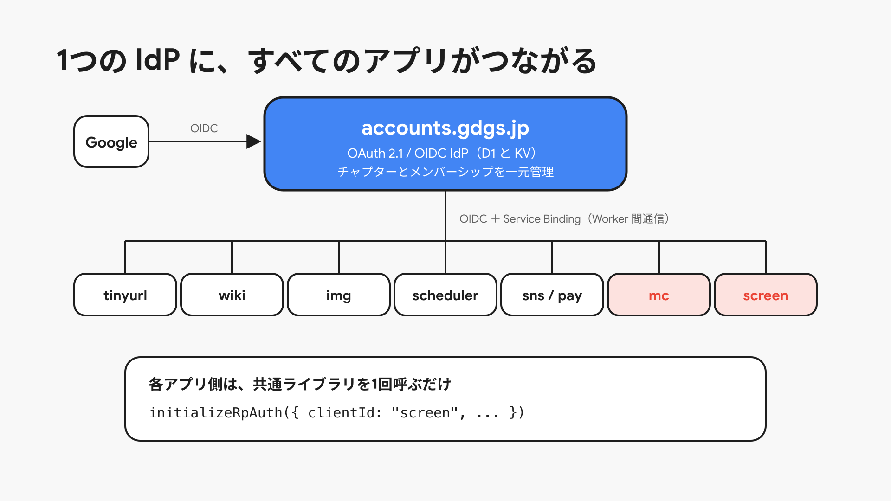

> 🗣 1つ目の軸は認証認可基盤です。
> Cloudflare 公式の OAuth Provider ライブラリで OIDC の IdP を作りました。
> 新しいアプリを作るときは、共通ライブラリの `initializeRpAuth` という関数を1つ呼ぶだけで、ログインまわりのルートがすべて生えます。
> セッションも署名付き Cookie で扱うので、DB にセッションテーブルを作る必要すらありません。

---

## 8. 認証基盤の本当のうれしさ ＝「数行で書ける権限管理」

- 「このチャプターの運営メンバーだけが管理画面に入れる」を、アプリ側の数行で書ける
  - `mc`、`screen`、`ost`、`roster` の管理画面はすべてこの仕組み
  - `live-checkin` は `gdg-kwansai` のメンバーだけに制限している
- Worker 間は **Service Binding** で通信するので、公開 HTTPS を経由せず高速・安全
- 外部にも OIDC で開いている（OIDC クライアントのデモ、`gdg` CLI のログイン）

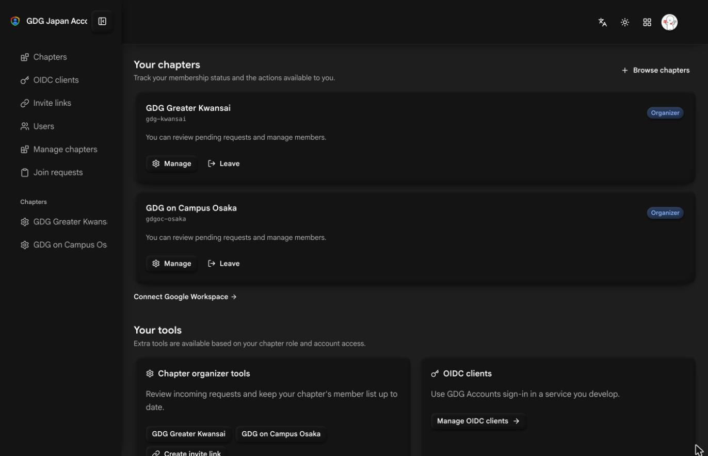

> 🗣 認証基盤を作って一番うれしかったのは、ログインそのものよりも「権限管理」です。
> どのユーザーがどのチャプターの運営メンバーかを `accounts` で一元管理しているので、「関西チャプターの運営だけが入れる管理画面」が数行で書けます。
> Worker 同士は Cloudflare の Service Binding で直接つながるので、公開ネットワークを経由することもありません。

---

## 9. 軸②: デザインシステム `packages/design-system`

- **きっかけ（アプリが10個を超えたころ）**
  - アプリごとに余白やボタン、ダークモードの挙動が微妙に違う
  - UI の品質を上げるために、毎回 AI に長いプロンプトを書くのがつらい
- **中身（独立リポジトリ `gdg-jp/design-system` を submodule で取り込み）**
  - React 19、Radix Primitives、CSS トークン。Light / Dark の両方に対応
  - 約80のコンポーネント（`AppShell`、`FormField`、`DataTable`、`Sidebar` …）
  - **`DESIGN.md`**: トークンと設計判断の正本。人間だけでなく **AI もこれを読む**
  - テスト: 公開 API、SSR、色のコントラスト、axe（アクセシビリティ）、画像比較

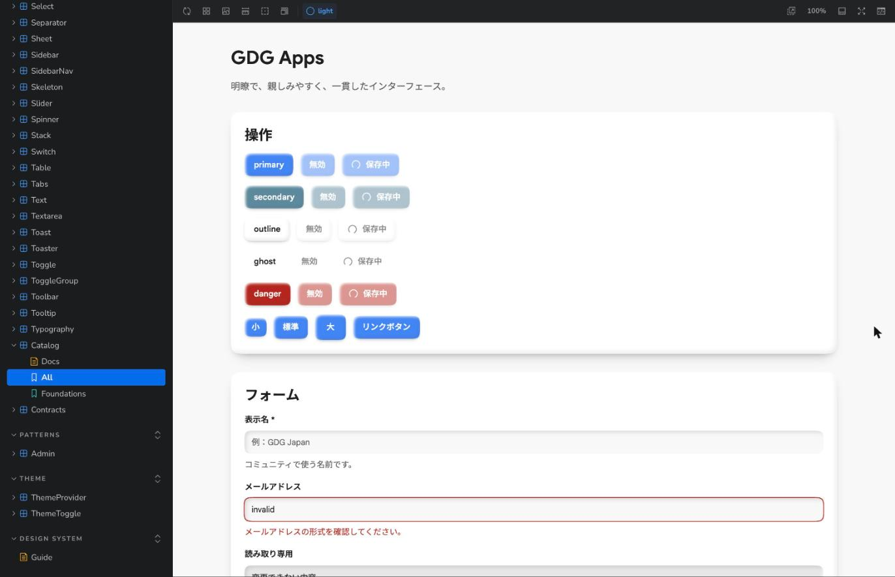
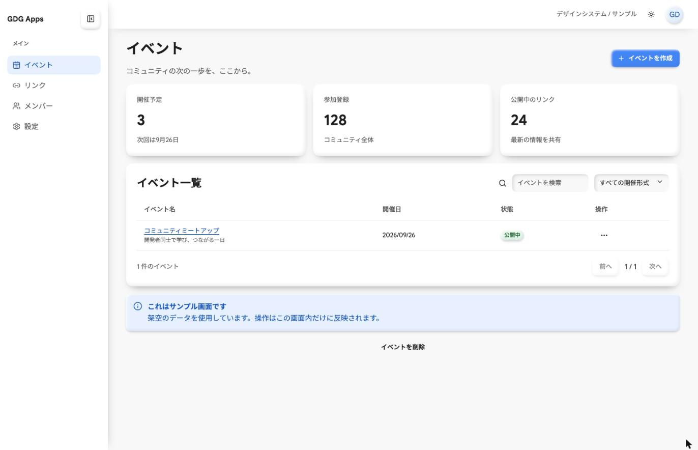

> 🗣 2つ目の軸はデザインシステムです。
> アプリが10個を超えたころ、アプリごとに見た目が微妙にズレてしまい、それを直すために毎回長いプロンプトを書くのに疲れ果てて作りました。
> 約80個のコンポーネントと、設計判断を言語化した `DESIGN.md` を用意していて、AI エージェントもこの `DESIGN.md` を読んで画面を組み立てます。

---

## 10. デザインシステムを「守らせる」仕組み

作って終わりではなく、**AI が規約を破れない仕組み**とセットで運用する

- **アプリ側の UI 規約チェッカー**（ルールごとに ID を付与し、違反すると CI が落ちる）
  - `legacy-import`: `lucide-react` や `radix-ui` などの直接 import を禁止
  - `literal-color`: `#xxxxxx` や `rgb()` の色ベタ書きを禁止
  - `semantic-color`、`button-full-width`、`form-field-hide-label` …
  - どうしても例外を作るときは、コード上に理由（`rationale`）を書く必要がある
- **`gdg-design` skill**: GDG ブランドのロゴ、色、タイポグラフィ、ステッカーの使い方を AI に教える
- **効果**: プロンプトで UI を細かく注文しなくても、最初から GDG らしい画面が出てくる

> 🗣 デザインシステムで重要なのは、作るだけでなく「守らせる仕組み」とセットにすることです。
> AI は放っておくと、勝手にアイコンライブラリを直接 import したり、カラーコードをベタ書きしたりします。
> そこで専用の UI 規約チェッカーを作り、違反したら CI を落とすようにしました。例外には理由の記述を必須にしています。
> これにより、プロンプトで細かく指示しなくても、最初から統一された GDG らしい画面が出てくるようになりました。

---

## 11. 軸③: ハーネスエンジニアリング① ローカルの pre-commit CI

AI エージェントに高速でコードを書かせるなら、**「壊れたコードをコミットさせない」柵（ハーネス）**が要る

- Git の pre-commit フックで `pnpm ci:staged` を自動実行
  - staged なファイルを見て、実行するチェックを動的に選ぶ（Biome、型検査、Vitest、ビルド、Playwright E2E、Go）
  - 変更したアプリの E2E だけを走らせ、共有コードを触ったときは全件を走らせる
- AI エージェントがコミットするたびに CI が走るので、壊れたコードはコミットできない
- 実行時間、キャッシュヒット、テストごとの時間を毎回 JSON に記録して計測する

> 🗣 3つ目の軸がハーネスエンジニアリングです。
> AI エージェントに猛スピードで実装させると、当然ミスもします。
> そこで、コミット時の pre-commit フックで、ステージされたファイルから必要な型検査・ビルド・Playwright の E2E テストだけを選んで走らせています。
> これによって、AI は壊れたコードをそもそもコミットできなくなります。

---

## 12. ハーネスが機能する条件 ＝「圧倒的な速さ」

**pre-commit が遅いと、人も AI も `--no-verify` でフックを飛ばしたくなる。**
飛ばされた瞬間、CI はハーネスとして機能しなくなる。

| 計測タイミング | pre-commit CI の所要時間 |
| --- | --- |
| チューニング前 | **3〜30分** |
| チューニング後 | **1秒〜1分** |

- **1秒〜1分に縮めるためにやったこと**
  - 型検査とビルドを1つの Turbo グラフにまとめ、依存先のビルドを1回で済ませる
  - 独立した E2E を最大4並列で走らせ、ビルド済みの Worker を E2E で再利用する
  - Vite 8 とネイティブ TypeScript 7 コンパイラ（`tsgo`）に乗り換える
  - テストだけを変えたときは、関連するテストと型検査だけを走らせる

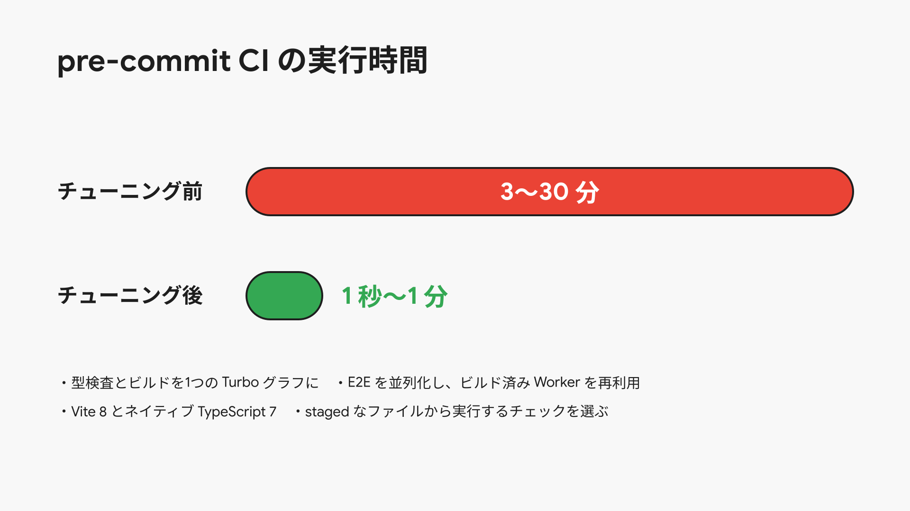

> 🗣 ただし、pre-commit フックには致命的な罠があります。「遅いと、人も AI もフックを飛ばしたくなる」ということです。
> 以前は3分から30分かかっていましたが、これではハーネスとして機能しません。
> そこで毎回ログを JSON で計測し、Turbo グラフの統合、E2E の並列化、TypeScript 7 のネイティブコンパイラへの移行をやり切りました。
> 今では1秒から1分で終わるので、AI が何度コミットしてもストレスなく品質を守れます。

---

## 13. ハーネスエンジニアリング②: Agent Skills と `AGENTS.md`

AI の「作業の進め方」と「作ったアプリの運用」も型化する

| Skill / 仕組み | 用途 |
| --- | --- |
| **`wayfinder`** | 1セッションに収まらない大きな作業を、Issue 上の「判断チケットの地図」にして1つずつ決める |
| **`grilling` / `grill-with-docs`** | 実装に入る前に、計画の穴を AI に質問攻めにしてもらって潰す |
| **`gdg-design`** | GDG ブランドに沿ったグラフィックや UI を作る |
| **`gdg-wiki` / `gdg-tinyurl` / `gdg-img` / `gdg-sns` …** | 内製したアプリ自体を、`gdg` CLI 経由で AI から直接操作する |

- **`AGENTS.md`**: ディレクトリ構成（feature-first）、コマンド、規約を1ファイルに集約
- 外部から取り込んだ skill は、ハッシュでバージョンを固定して安全に運用

> 🗣 コードの検査だけでなく、AI の「仕事の進め方」も Agent Skills で型化しています。
> 実装前に `grilling` で設計の穴を AI に質問攻めにしてもらったり、`wayfinder` で判断を分割したりしています。
> さらに面白いのが一番下で、内製したアプリ用の CLI と Skill も作っているので、「Wiki を更新して」「短縮リンクを発行して」と AI に頼むだけで、作ったアプリ自体を AI が操作してくれます。

---

## 14. 土台としての Cloudflare: インフラ構築時間をゼロにする

| やりたいこと | Cloudflare の機能 | 使っているアプリ |
| --- | --- | --- |
| CRUD | D1、R2、KV | ほぼすべて（D1 は12アプリ） |
| リアルタイム通信 | Durable Objects と WebSocket | `ost`、`mc`、`screen`、`wiki` の共同編集 |
| 映像と音声の配信 | Realtime SFU | `screen` |
| Worker 間通信 | Service Bindings | 13アプリ（`accounts` への OIDC など） |
| 非同期処理 | Queues、Cron | `wiki`、`connpass`、`sns` |
| o11y | Workers Logs、Analytics Engine | 13アプリで observability を有効化 |
| AI と検索 | Workers AI、Vectorize、Browser Rendering | `wiki`、`connpass` |

- どれも **`wrangler.toml` に数行書くだけ** で使えるため、インフラを組む時間がほぼゼロ

> 🗣 そして、これら3つの軸を下から支えているのが Cloudflare です。
> DB やストレージだけでなく、WebSocket のリアルタイム通信、映像配信の SFU、Worker 間通信まで、すべて `wrangler.toml` に数行書くだけで立ち上がります。
> インフラ構築の時間がゼロだからこそ、コードを書くことだけに集中できます。

---

## 15. 伏線回収: だから「数時間」で複雑なアプリが立ち上がる

**例: `screen.gdgs.jp`（リモート登壇者フィード / 2026-10-20 深夜）**

- **作ったもの**: 登壇者が招待リンクを開くだけでカメラ・マイク・画面共有を送れ、管理画面から出力スロット割当・トークバック・カンペ送信ができるシステム（DeepFilterNet3 によるノイズ抑制付き）
- **00:48** 最初のコミット（91ファイル、約8千行）→ **04:28** にはデバイス選択・チャット・ノイズ抑制まで完成

| 要素 | 新規開発でやったこと |
| --- | --- |
| 運営のログイン・チャプター権限 | `accounts` の `initializeRpAuth` を呼ぶだけ |
| コントロールルームの UI | `design-system` のコンポーネントを並べるだけ |
| SFU 映像配信・状態同期 | Cloudflare Realtime SFU と Durable Objects を呼ぶだけ |
| 品質保証 | 1分以内の pre-commit CI が自動で担保 |
| **人間と AI が考えたこと** | **「登壇者と配信オペレーターにどんな体験を提供するか」だけ** |

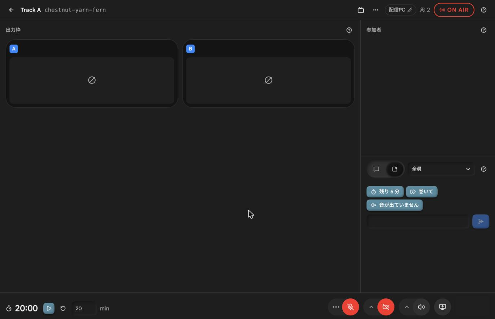

> 🗣 ここで冒頭の話に戻ります。
> DevFest 当日に3時間で作った `mc` に続き、2日後には WebRTC の SFU とノイズ抑制を使ったリモート登壇者システム `screen` も、深夜0時48分から4時28分までの約3時間半で完成しました。
> なぜこれが可能だったかというと、認証は `accounts` に、UI はデザインシステムに、インフラは Cloudflare に、品質検査は1分の pre-commit CI にすべて任せて、私と AI は「このアプリ固有のロジック」だけを書いたからです。

---

## 16. ただし注意①: 最初から基盤を作るのはアンチパターン

「よし、明日からまず最強の基盤を作ろう！」は **絶対に失敗する（YAGNI）**

- 私の基盤もすべて **「実際に困ってから」** 作った
  - **認証基盤 (`accounts`)**: 2つ目のアプリでログインの重複に困ってから
  - **デザインシステム**: アプリが10個を超えて、見た目のバラつきとプロンプトに疲れてから
  - **CI の高速化**: 遅さのせいでフックを飛ばしたくなってから
- 何が共通になるかは、アプリを2〜3個作ってみるまで絶対にわからない
- 最初から基盤を作ると過剰設計になり、肝心のアプリが1つも出てこない

> 🗣 ここまで聞くと、「よし、うちも最初にこの3つの基盤を全部作ろう！」と思うかもしれません。
> でも、それは最大のアンチパターンです。
> 私も最初からこれを作ったわけではなく、すべて「困ってから」作りました。
> 何を共通化すべきかは、実際にアプリを2つ3つ作ってみるまでわかりません。最初から基盤を作ると、基盤づくりで力尽きて肝心のアプリが出てこなくなります。

---

## 17. 注意②: 最初のコードは汚くていい（後から綺麗にする）

- `design-system` も、最初から今の形だったわけではない
  - **2026-04**: `accounts` に `shadcn/ui` を入れただけ
  - **2026-07**: ナビゲーションやテーマ切り替えを、アプリ間で少しずつ共有し始める
  - **2026-10-05**: 独立リポジトリに切り出し、5アプリを一度に移行
- アプリのディレクトリ構成も、後から feature-first にリファクタリングした
- **AI エージェントがいる今、リファクタリングのコストは以前より圧倒的に安い**
  - ただし、「壊したら1分以内に気づけるテストと CI（ハーネス）」があることが大前提

> 🗣 もう1つ伝えたいのは、「最初のコードは汚くて構わない」ということです。
> デザインシステムも最初は1つのアプリに shadcn を入れただけでしたし、後から別リポジトリに切り出して5つのアプリを一気に移行しました。
> AI エージェントがいる今、後からコードを綺麗にするコストは劇的に下がっています。
> ただし、安心して大改造できるのは、壊した瞬間に気づけるテストと高速な CI というハーネスがあるからです。

---

## 18. まとめ: 持ち帰ってほしい3つの軸とサイクル

| 軸 | 具体例 | 新規アプリ開発で得られるもの |
| --- | --- | --- |
| **① 認証認可基盤** | `accounts.gdgs.jp`（OIDC IdP）と `initializeRpAuth` | ログインとチャプター単位の権限が数行で手に入る |
| **② デザインシステム** | `@gdgjp/design-system`、`DESIGN.md`、UI 規約チェッカー | プロンプトで注文しなくても統一された UI になる |
| **③ ハーネス** | 1秒〜1分で終わる pre-commit CI と Agent Skills | AI が壊したコードをコミットできず、進め方にも迷わない |

1. **まずは目の前の「困った」を解決する1つ目のアプリを、汚くてもいいから作る**
2. **2個目、10個目と作って本当に痛みがわかってから、基盤（ハーネス）として切り出す**
3. **すると、次のアプリは「2〜3時間で本番品質」になる**

> 🗣 まとめです。
> 認証認可基盤、デザインシステム、そして高速な CI と Skills というハーネスを整えると、新しいアプリは2〜3時間で本番品質になります。
> でも、最初から全部を作る必要はありません。
> まずは目の前の「困った」を解決する1つ目のアプリを作り、痛みがわかってから1つずつ基盤にしていく。
> 皆さんの身の回りの「困った」も、ぜひこのサイクルで内製化して解決してみてください。ありがとうございました！

---

## 参考資料

- gdg-jp/design-system https://github.com/gdg-jp/design-system
- mattpocock/skills（wayfinder、grilling、grill-with-docs） https://github.com/mattpocock/skills
- Cloudflare `workers-oauth-provider` https://github.com/cloudflare/workers-oauth-provider
- Cloudflare Realtime https://developers.cloudflare.com/realtime/
- dub.sh https://dub.co/pricing
